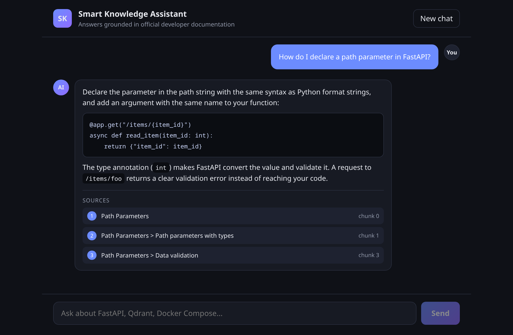
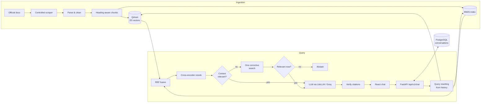

# Smart Knowledge Assistant

A Retrieval-Augmented Generation (RAG) assistant that answers developer questions from
official technical documentation and cites the exact sections it used.



## Highlights

- **Controlled documentation scraper:** httpx + BeautifulSoup, robots.txt-aware, with
  domain allowlists, page/depth limits and rate limiting. Re-runs are idempotent thanks to a
  content-hash registry.
- **Structure-aware chunking:** every chunk keeps its heading path
  (`FastAPI > Tutorial > Path Parameters`), so context survives splitting.
- **Hybrid retrieval:** dense search in Qdrant (`multilingual-e5-small`) plus BM25 keyword
  search, merged with Reciprocal Rank Fusion.
- **Cross-encoder reranking:** the 10 fused candidates are rescored by
  `ms-marco-MiniLM-L-6-v2`, and the best 5 become the LLM context.
- **Reliability layer:**
  - retrieval validation from cross-encoder scores;
  - one corrective search on weak results (lightweight CRAG);
  - abstention instead of hallucination;
  - citation verification against the retrieved chunks.
- **Conversation memory:** PostgreSQL history, with follow-up questions rewritten into
  standalone queries by the LLM.
- **Evaluation:** RAGAS (faithfulness, answer relevancy, context precision and recall) on a
  35-question golden dataset that includes unanswerable probes.
- **Tests:** 350+ Pytest tests. The LLM, vector store and models are mocked, so the suite
  runs offline.

## Architecture



| Retrieval step | Configuration |
| --- | --- |
| Dense search | Qdrant, cosine, 384-dim E5 vectors with `query:` / `passage:` prefixes, top 20 |
| Sparse search | `rank_bm25` BM25Okapi, top 20 |
| Fusion | RRF, k = 60, top 10 |
| Reranking | Cross-encoder, final top 5 |
| Validation | top score ≥ 2.0 relevant, ≥ −3.0 partial, below that irrelevant (calibrated on real logits) |

More detail: [docs/ARCHITECTURE.md](docs/ARCHITECTURE.md),
[docs/RELIABILITY.md](docs/RELIABILITY.md) and [docs/EVALUATION.md](docs/EVALUATION.md).

## Tech stack

| Area | Technology |
| --- | --- |
| Backend | Python 3.12, FastAPI, Pydantic Settings, uv |
| Ingestion | httpx, BeautifulSoup, LangChain Documents + text splitters |
| Embeddings | Sentence Transformers, `intfloat/multilingual-e5-small` |
| Retrieval | Qdrant, rank-bm25, RRF, cross-encoder reranking |
| LLM | LiteLLM (Groq) |
| Storage | PostgreSQL + SQLAlchemy |
| Evaluation | RAGAS |
| Frontend | React 19, TypeScript, Vite |
| Infrastructure | Docker Compose (Qdrant, PostgreSQL), Pytest |

## Evaluation

The latest RAGAS run (5-question smoke run, judge `qwen/qwen3.8-27b`):

| Faithfulness | Answer relevancy | Context precision | Context recall |
| --- | --- | --- | --- |
| 0.73 | 0.74 | 0.96 | 0.80 |

```bash
cd backend
uv run python -m app.evaluation.evaluation_runner --limit 5                # baseline
uv run python -m app.evaluation.evaluation_runner --limit 5 --reliability  # with the reliability layer
```

## Getting started

Requirements: Python 3.12 with [uv](https://docs.astral.sh/uv/), Node 20+, Docker, and a
Groq API key.

```bash
# 1. Configuration
cp .env.example .env          # set GROQ_API_KEY

# 2. Qdrant + PostgreSQL
docker compose -f infrastructure/docker/docker-compose.yml up -d

# 3. Backend dependencies and tests
cd backend
uv sync
uv run pytest

# 4. Ingest and index a documentation source
uv run python -m app.ingestion.cli --source fastapi --max-pages 20
uv run python -m app.vector_store.cli index --all
uv run python -c "from app.retrieval.bm25_indexing import build_bm25_index; build_bm25_index()"

# 5. Start the API (http://127.0.0.1:8000/docs)
uv run uvicorn app.main:app --reload
```

In a second terminal, start the frontend:

```bash
cd frontend
npm install
npm run dev                   # http://localhost:5173 (proxies /api to :8000)
```

Open `http://localhost:5173/?demo` to see the sample conversation from the screenshot
without running the backend.

## API

| Method | Endpoint | Description |
| --- | --- | --- |
| `GET` | `/health` | Liveness probe |
| `POST` | `/api/v1/chat` | `{ "message", "conversation_id"? }` → `{ conversation_id, answer, citations[] }` |
| `GET` | `/api/v1/conversations/{id}` | Conversation messages |

## Project structure

```
rag-assistant/
├── backend/app/
│   ├── api/            # FastAPI routers and schemas
│   ├── core/           # Settings and logging
│   ├── database/       # SQLAlchemy models and conversation repository
│   ├── ingestion/      # Scraper, parser, chunking, deduplication, CLI
│   ├── embeddings/     # E5 embedding service
│   ├── vector_store/   # Qdrant collection, indexing, semantic search
│   ├── retrieval/      # BM25, hybrid + RRF, reranker, rewriting, reliability, generation
│   └── evaluation/     # RAGAS runner, golden dataset, reports
├── backend/tests/      # Pytest suite
├── frontend/           # React + TypeScript chat UI
├── infrastructure/     # Docker Compose
└── docs/               # Architecture, reliability, evaluation, decisions
```

## Roadmap

- Index the other configured sources (Qdrant, Docker Compose, React, PostgreSQL docs)
- Streaming responses (SSE)
- PDF upload as an additional source
- Conversation list and deletion in the API and UI
- Observability with Langfuse, CI with GitHub Actions

Design decisions and their rationale: [docs/TECHNICAL_DECISIONS.md](docs/TECHNICAL_DECISIONS.md).
